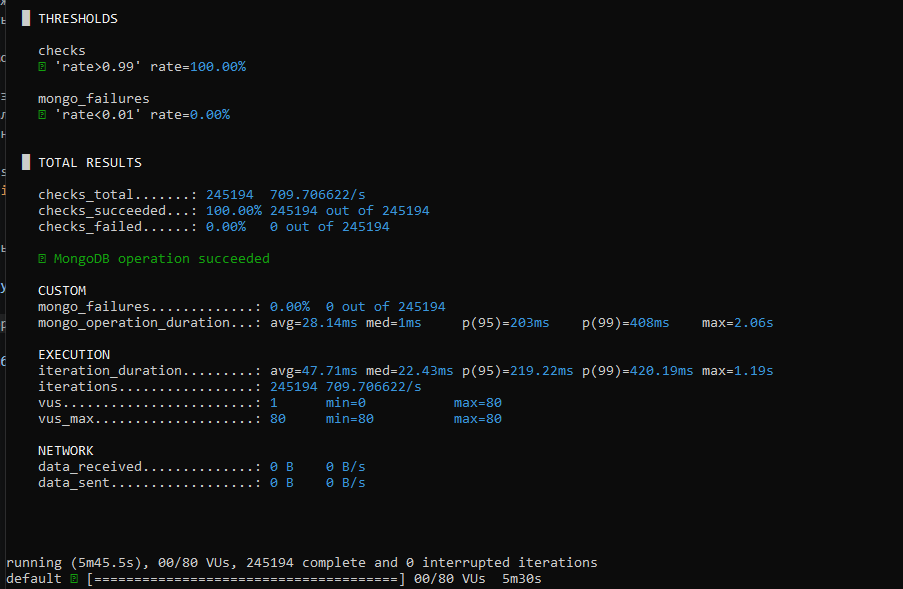
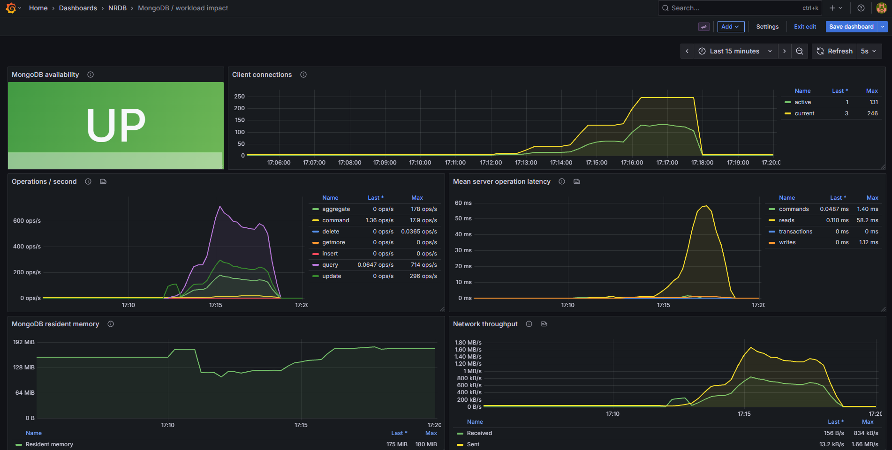
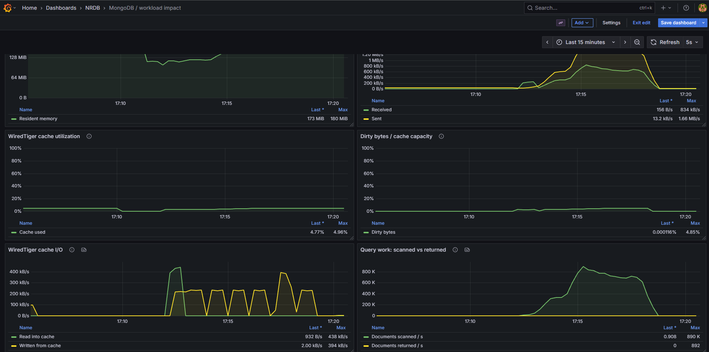

# Лабораторная работа №1. Эксплуатация MongoDB

## Часть 1. Базовая настройка

`setup.yml` ставит MongoDB из архива, создает службу и включает автозапуск.
`restart.yml` управляет службой и проверяет доступность порта.

```bash
ansible-playbook -i localhost, -c local setup.yml -K
ansible-playbook -i localhost, -c local restart.yml -K

```

## Часть 2. Управление ролевой моделью

`roles.yml` включает авторизацию, создает администратора и учебных пользователей.
Есть роли для чтения, редактирования базы `university` и чтения только коллекции `courses`.

```bash
ansible-playbook -i localhost, -c local roles.yml -K

# Выдать / отозвать роль редактора у trainee
ansible-playbook -i localhost, -c local roles.yml -K --tags grant
ansible-playbook -i localhost, -c local roles.yml -K --tags revoke

# Изменить права роли
ansible-playbook -i localhost, -c local roles.yml -K --tags permissions \
  -e '{"editor_actions":["find","insert","update","remove"]}'

# Доступ к одной коллекции
ansible-playbook -i localhost, -c local roles.yml -K --tags collection

# Удалить пользователя courses_guest и его роль
ansible-playbook -i localhost, -c local roles.yml -K --tags delete
```

## Часть 3. Резервное копирование и восстановление

`backup.yml` делает копии через `mongodump` и восстанавливает коллекцию через
`mongorestore`. Копии лежат в `/var/backups/mongodb`, каждый раз в новом каталоге.

```bash
# Одна база
ansible-playbook -i localhost, -c local backup.yml -K

# Все указанные учебные базы
ansible-playbook -i localhost, -c local backup.yml -K --tags backup \
  -e '{"backup_mode":"all","study_databases":["university"]}'

# Восстановить удаленную коллекцию
ansible-playbook -i localhost, -c local backup.yml -K --tags restore \
  -e backup_path=/var/backups/mongodb/one-XXXXXXXX -e restore_collection=courses
```

## Часть 4. Мониторинг

`monitoring.yml` настраивает Percona MongoDB Exporter и пользователей для мониторинга
и нагрузки. Prometheus и Grafana работают в Docker.
Метрики собираются раз в 15 секунд.


```bash
ansible-playbook -i localhost, -c local monitoring.yml -K
docker compose -f monitoring/compose.yml up -d
```

Свой дэшборд на 10 панелей: доступность базы, соединения, операции/с, задержки,
память, трафик, заполненность и измененные данные кеша WiredTiger, его I/O,
просмотренные и возвращенные документы.

Нагрузка из `monitoring/load.js` запускается через k6: чтения, обновления и агрегации,
ступени 10 -> 40 -> 80 пользователей.

```bash
./monitoring/bin/k6 run monitoring/load.js
```

Результат k6:



Дэшборд после нагрузки:



