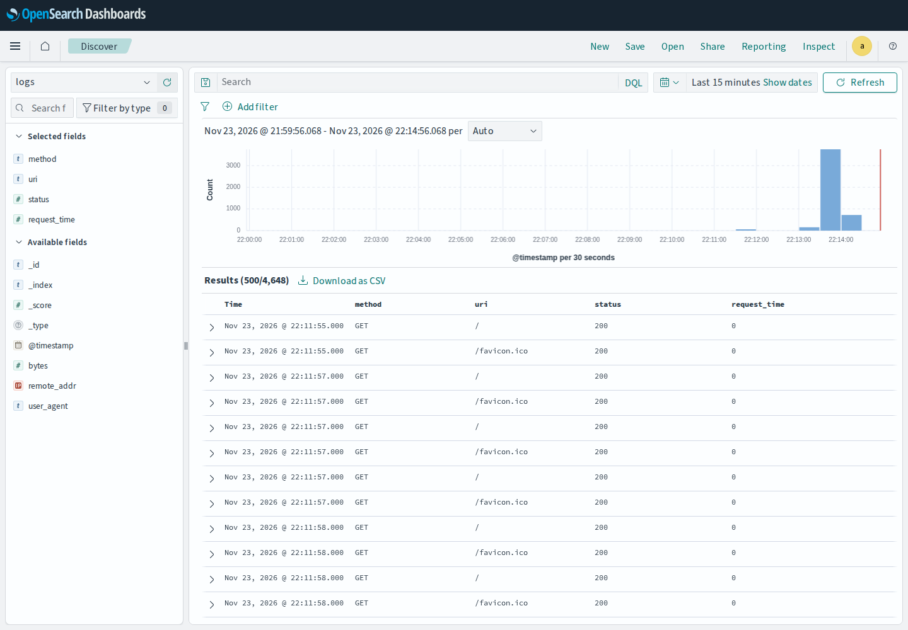
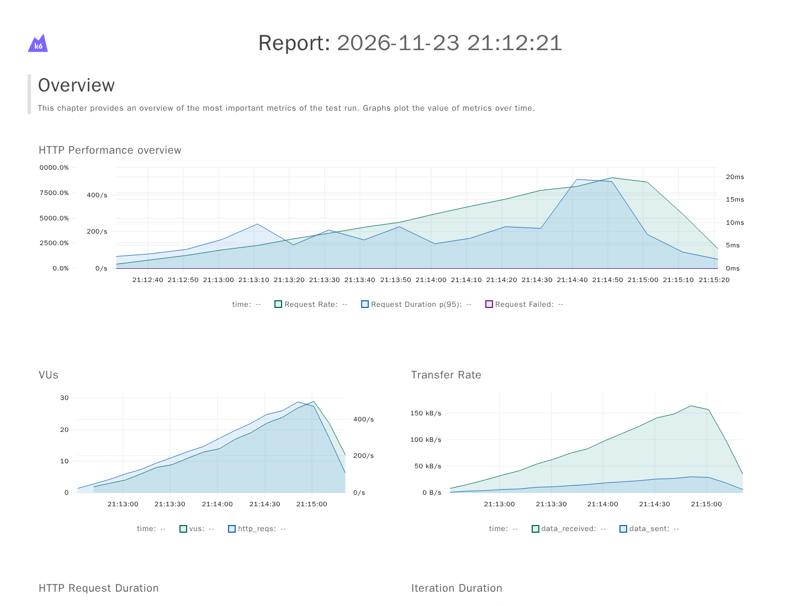
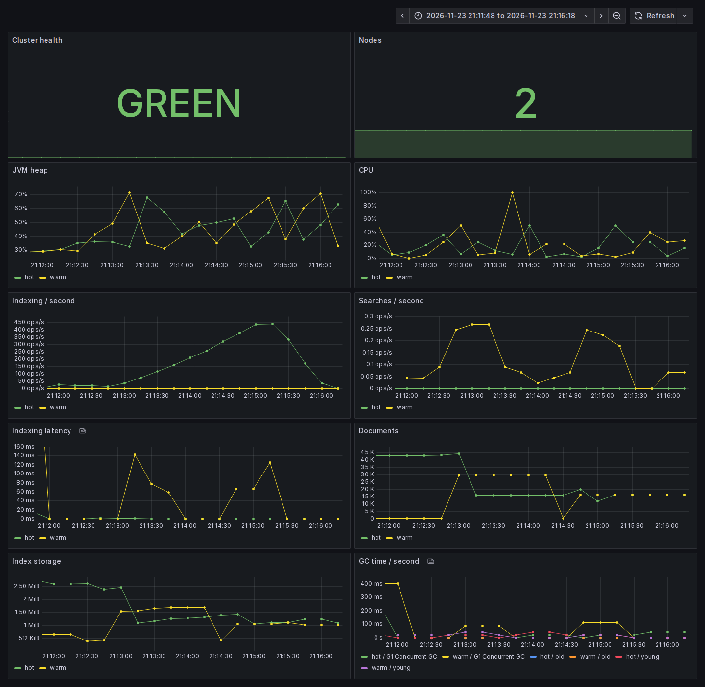

# Лабораторная работа №2. Эксплуатация OpenSearch 3.8

## Часть 1. Развертывание

Два узла OpenSearch 3.8.0, hot для новых логов и warm для старых.
На транспортном и REST уровне включен TLS, у каждого узла свой сертификат.
OpenSearch Dashboards подключается по HTTPS с проверкой сертификата.

setup.yml создает сертификаты и запускает кластер в Docker.
Настройки узлов лежат в opensearch.yml.j2, интерфейса в dashboards.yml.j2.

```bash
ansible-playbook -i localhost, -c local setup.yml -K
```

Dashboards: http://localhost:5601



На скрине свежие логи nginx после нагрузки, с полями метода,
адреса запроса, статуса ответа и времени обработки

## Часть 2. Ролевая модель

roles.yml создает три пользователя и свои роли:

- `log_writer` / `logs_write` - запись только в `logs`
- `log_reader` / `logs_read` - чтение `logs*`
- `monitor` / `metrics_read` - получение метрик кластера и узлов без чтения документов

Logstash работает от log_writer, prometheus - от monitor.
Для служебного подключения Dashboards используется kibanaserver.

```bash
ansible-playbook -i localhost, -c local roles.yml
```

## Часть 3. Управление индексами

nginx раздает страницу http://localhost:8080 и пишет обращения в JSON.
Logstash читает файл логов и отправляет записи по HTTPS в logs.
Шаблон задает типы полей: время, ip адрес, метод, URI, статус, размер ответа,
длительность запроса и User-Agent.

logs.yml запускает сбор логов и настраивает discover. Политика и шаблон
индексов явно описаны в logs-config.yml, конвейер в logstash.conf.

```bash
ansible-playbook -i localhost, -c local logs.yml
```

Политика делает rollover при 1 МБ или возрасте 1 минута - что наступит раньше.
Старый индекс переносится на warm, при возрасте 10 минут удаляется.

Удаляются целые индексы, возраст считается с момента создания индекса.

При проверке новые индексы оставались на hot, старые переносились на warm.
Первый индекс после rollover был удален автоматически.

## Часть 4. Мониторинг

На обоих узлах установлен плагин `prometheus-exporter`.

```bash
ansible-playbook -i localhost, -c local monitoring.yml
```

Grafana: http://localhost:3000/d/nrdb-opensearch

Дашборд на 10 панелей: состояние кластера, число узлов, JVM heap, CPU,
индексация и поиск в секунду, задержка индексации, документы, размер индексов и GC

Нагрузка на nginx через k6 длится 3 минуты, до 30 пользователей:

```bash
docker compose run --rm load
```

Результат: 44 671 запрос, ошибок нет, p95 времени запроса- 9,55 мс.



Дашборд после нагрузки:



Под нагрузкой растет скорость индексации, меняются CPU и JVM heap
Число документов и размер индексов уменьшаются при их переносе и удалении
