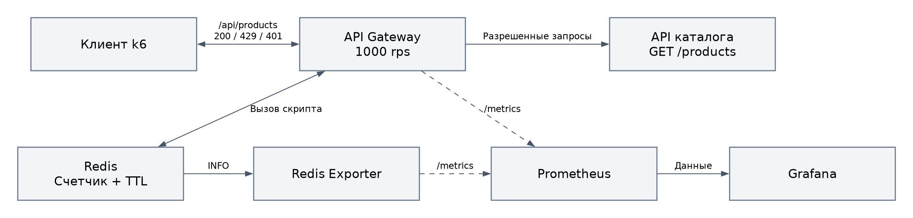
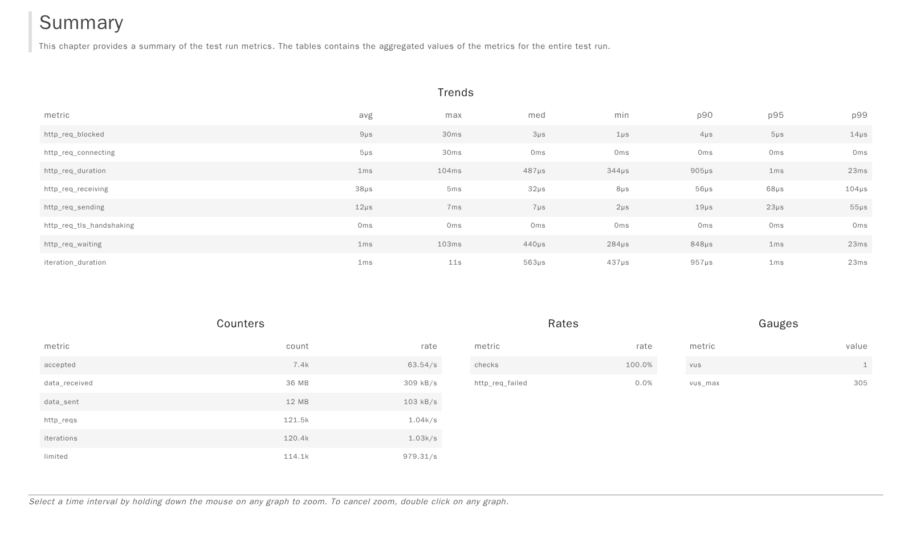
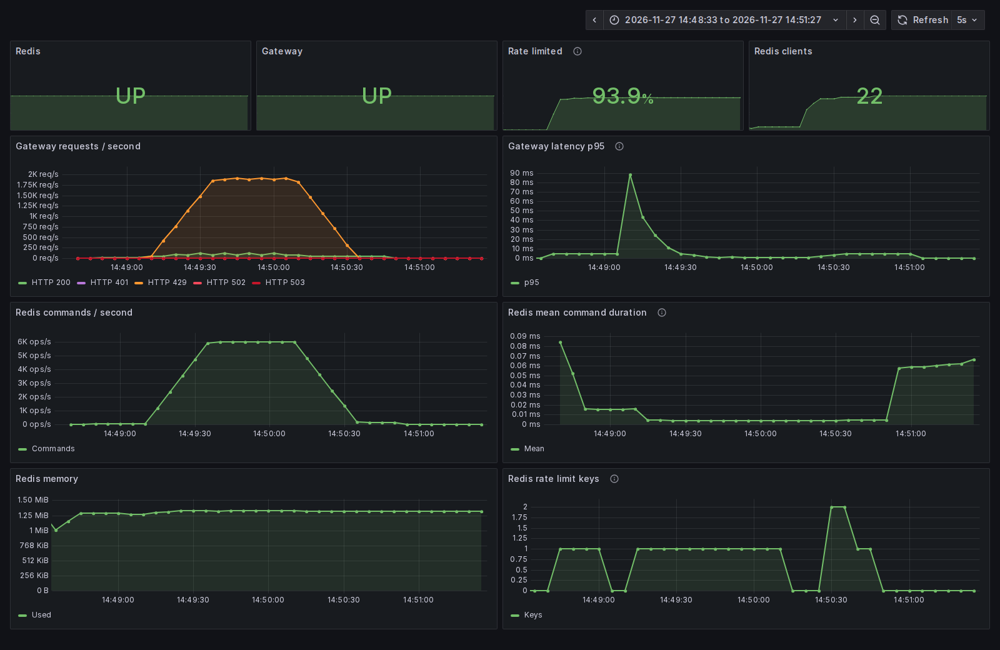

# Лабораторная работа №3. Эксплуатация Redis

## Задача и требования

Сценарий - ограничение частоты запросов к API каталога товаров.
Небольшой gateway проверяет лимит в Redis и только после этого
передает запрос в backend. Сам бэк возвращает два учебных товара.

Метод GET /api/products доступен без авторизации.
Общий лимит для всех запросов - 1000 обращений за 10 секунд.
При превышении лимита приходит `429` с заголовком `Retry-After`.
Метрики Redis и gateway собираются в Prometheus и отображаются в Grafana.

## Схема



## Развертывание

Из каталога lab3:
```bash
docker compose up -d --build
```

Пример запроса:

```bash
curl -i http://localhost:8080/api/products
```

В ответе приходят товары и заголовки `X-RateLimit-Limit`,
`X-RateLimit-Remaining`, `X-RateLimit-Reset`.
Последний показывает число секунд до сброса окна.

## Ограничение запросов

Используется фиксированное окно 10 секунд с первого запроса.
Redis хранит общий целочисленный счетчик `ratelimit:products` с TTL.
Скрипт увеличивает счетчик, задает TTL при создании и возвращает
число запросов и оставшееся время. Все выполняется атомарно,
поэтому параллельные запросы учитываются одним счетчиком.
Отклоненные запросы не продлевают окно и не доходят до backend.

## Нагрузка

```bash
docker compose run --rm load
```

k6 сначала отправляет 20 запросов/с в течение 20 секунд, затем после паузы -
2000 запросов/с в течение минуты. После окончания нагрузки проверяет
серию из 1100 запросов: ровно 1000 должны пройти, 100 получить 429.
Также проверяется восстановление доступа через 11 секунд.

В сохраненном прогоне фаза высокой нагрузки дала 120000 запросов за минуту,
примерно 2000 RPS. Пропущенных итераций и ошибок сервиса нет. p95 по всем ответам - 1,88 мс.



## Мониторинг

Для Redis используется `oliver006/redis_exporter`. У gateway две метрики:
счетчик ответов по HTTP-коду и гистограмма длительности запроса.

На дашборде 10 панелей. Redis и gateway показывают доступность базы
и сборщика метрик приложения. Rate limited - долю ответов 429
за выбранный период, Redis clients - число подключений к базе.

Gateway requests / second показывает ответы по HTTP-кодам, Gateway latency p95 -
длительность 95% запросов с учетом проверки лимита и обращения в backend.
Когда запросов нет, на графике задержки отображается ноль.

Redis commands / second и Redis mean command duration показывают скорость
и среднее время выполнения команд внутри Redis. Redis memory - занятую память,
Redis rate limit keys - число счетчиков, которые удаляются по TTL.



При росте нагрузки основная часть запросов получает 429, до backend
доходит только разрешенная квота. Число операций Redis растет вместе
с обращениями к gateway. После окончания нагрузки счетчики удаляются по TTL,
оба сервиса остаются доступны. Быстрые отказы тоже входят в измерение p95.
